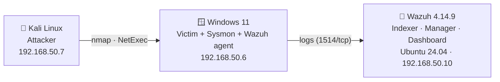
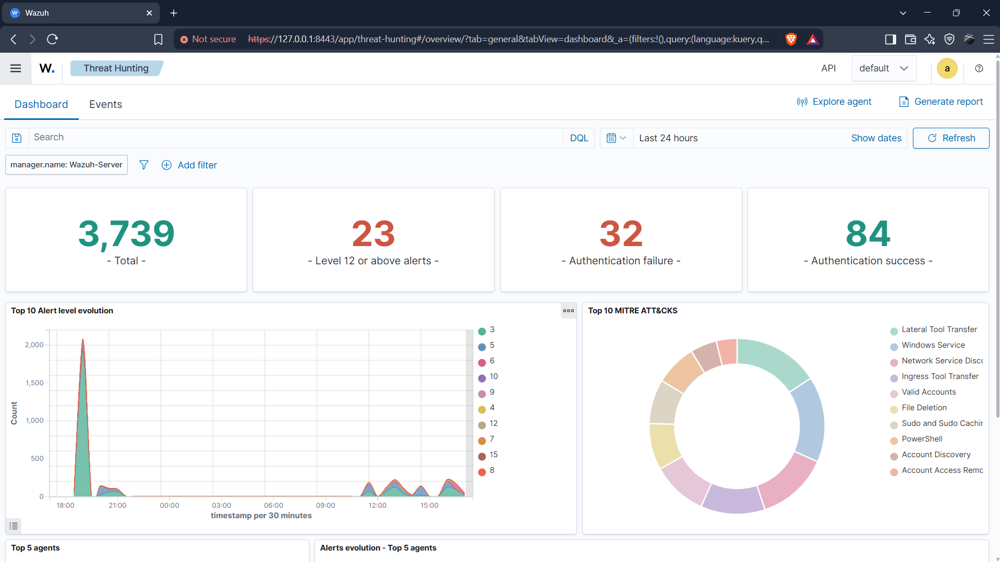
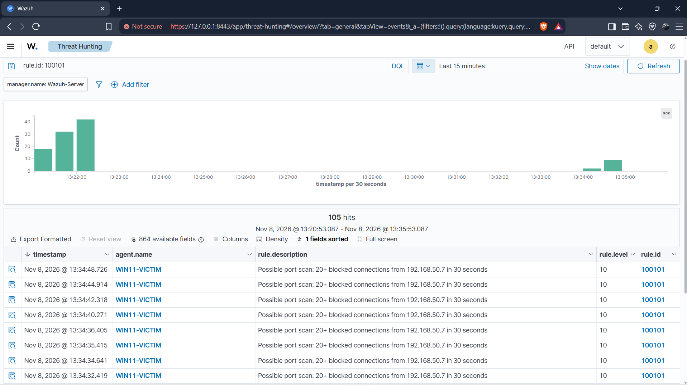
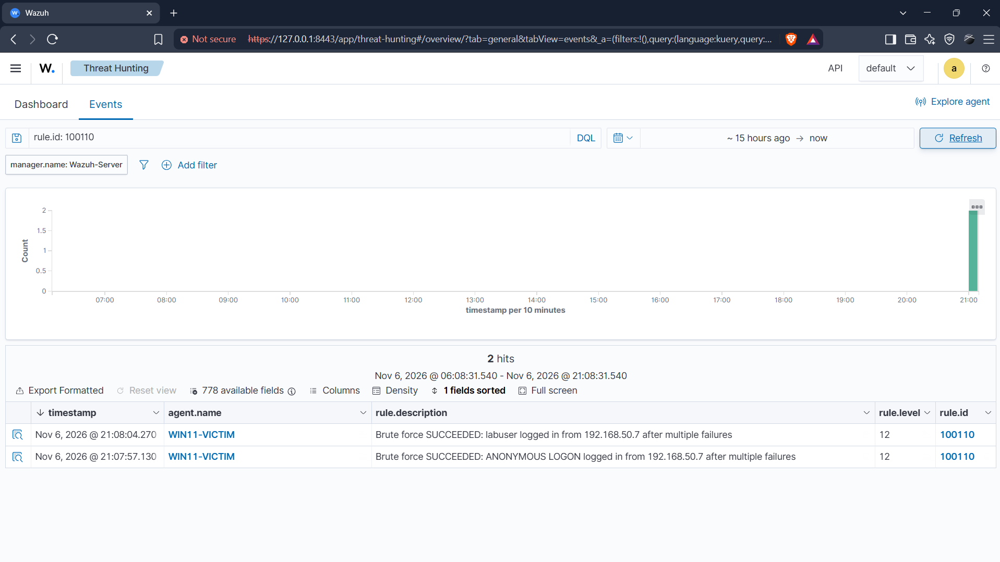
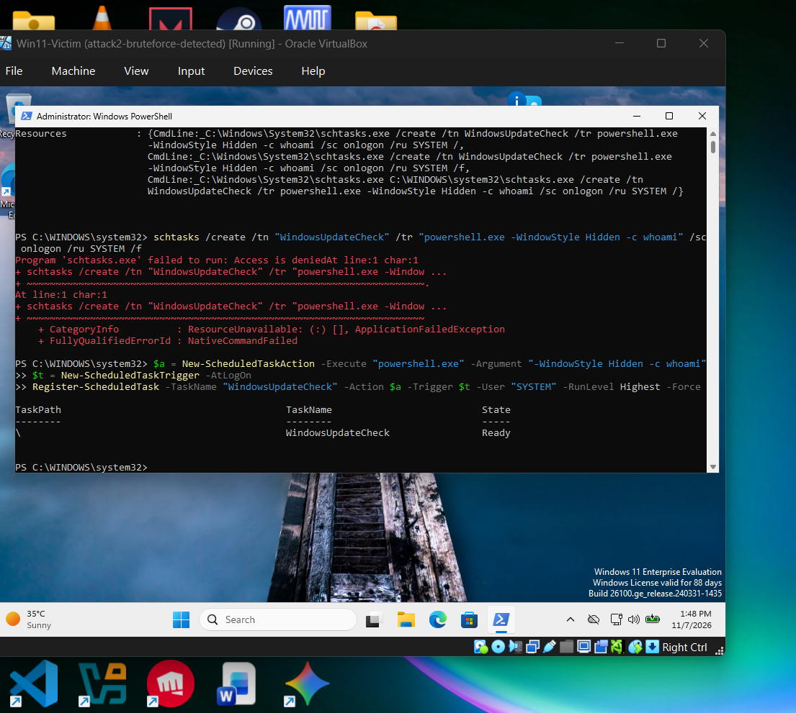
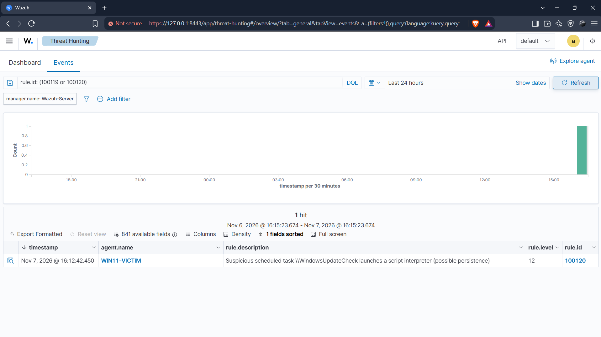
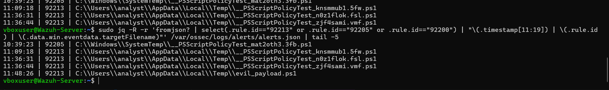

# 🛡️ Home SOC Lab — Detection Engineering with Wazuh

A self-built Security Operations Center lab: I attacked my own Windows endpoint from Kali Linux,
checked what a SIEM catches **by default**, found the blind spots, and closed them with
**custom telemetry, detection rules (mapped to MITRE ATT&CK) and false-positive tuning**.

> **Result:** 4 detection gaps found and closed, 5 custom detection rules, 6 tuning rules that cut idle alert noise by **~77%** —
> including catching a persistence technique that **bypassed Microsoft Defender**.

---

## Architecture



| Component | Details |
|---|---|
| Hypervisor | VirtualBox 7, isolated NAT network `SOC-Net` (192.168.50.0/24) |
| SIEM | Wazuh 4.14.9 all-in-one on Ubuntu Server 24.04 (6 GB RAM, 6 vCPU) |
| Endpoint | Windows 11 Enterprise 24H2 + Sysmon (SwiftOnSecurity config) + Wazuh agent |
| Extra log sources | Sysmon, PowerShell/Operational, **Windows Defender/Operational** |
| Attacker | Kali Linux 2026.3 (nmap, NetExec) |

---

## Results

| # | Attack | MITRE | Default Wazuh | After my work |
|---|---|---|---|---|
| 1 | Port scan (nmap SYN) | T1046 | ❌ Invisible | ✅ Rules **100100 / 100101** (lvl 10) + 2 telemetry fixes |
| 2a | SMB brute force — failed | T1110 | ✅ Detected + account lockout | — |
| 2b | SMB brute force — **succeeded** | T1110 | ❌ Not flagged | ✅ Rule **100110** (lvl 12), FP tuned |
| 3a | Hidden encoded PowerShell | T1059.001 | ✅ 92057 (lvl 12) | — |
| 3b | Backdoor admin account | T1136.001 / T1098 | ✅ 60154 (lvl 12) | — |
| 3c | `schtasks` persistence | T1053.005 | 🛡️ Defender blocked, SIEM blind | ✅ Defender log onboarded (lvl 12) |
| 3d | `Register-ScheduledTask` — **Defender bypass** | T1053.005 | ❌ Invisible everywhere | ✅ Event 4698 + rules **100119 / 100120** (lvl 12) |
| — | Alert tuning | — | ~140 alerts / idle hour, level-15 FPs | **33 alerts / hour (~77% less)**, 0 level-15 FPs |

### Highlights
- **Multi-layer root-causing:** the port scan was invisible because of *two* defaults — Windows
  didn't audit packet drops, **and** the Wazuh agent filtered Event 5152/5157 before sending.
- **Defense in depth, demonstrated:** Defender blocked `schtasks.exe`; the attacker switched to
  `Register-ScheduledTask` and bypassed it; my SIEM rule still caught it.
- **Tuning my own rules:** rule 100100 fired on outbound traffic and reply ports; rule 100110
  fired on `ANONYMOUS LOGON`. Both fixed.
- **Validated suppressions:** found that tuning regexes silently failed (escaped backslashes in
  Windows paths), fixed and proved with benign + malicious tests.

---

## Evidence

**Dashboard: alerts mapped to MITRE ATT&CK**


**Attack 1: port scan from Kali, caught by custom rule 100100 / 100101**


**Attack 2: a successful brute force flagged by custom rule 100110 (not detected by default)**


**Attack 3: Defender bypassed with Register-ScheduledTask...**


**...but the SIEM still caught it (custom rule 100120, level 12)**


**Tuning validated: benign PowerShell noise silenced, malicious script still alerts**


All screenshots: [`screenshots/`](screenshots/)

---

## Repository

```
├── rules/local_rules.xml            # all custom detection + tuning rules
├── config/agent.conf                # centralized agent config (Sysmon, PowerShell, Defender logs)
├── scripts/
│   ├── windows-victim-setup.ps1     # Sysmon, agent, audit policy, lab weakening
│   ├── wazuh-server-hardening.sh    # install + stability fixes (timeouts, swap)
│   └── noise-analysis.sh            # alert-volume analysis used for tuning
├── reports/
│   ├── 01-port-scan.md
│   ├── 02-smb-brute-force.md
│   ├── 03-post-exploitation.md
│   └── 04-alert-tuning.md
├── docs/troubleshooting.md          # 11 real problems and how I fixed them
└── screenshots/
```

## Reproduce
1. Build the 3 VMs on an isolated VirtualBox NAT network (`192.168.50.0/24`).
2. Wazuh server: `scripts/wazuh-server-hardening.sh`, then copy `rules/` and `config/`.
3. Windows victim: run `scripts/windows-victim-setup.ps1` as admin.
4. Run the attacks in `reports/` and watch **Threat Hunting → Events** in the dashboard.

## Skills
SIEM engineering (Wazuh / OpenSearch) · Windows event logging & audit policy · Sysmon ·
Detection rules & correlation · MITRE ATT&CK mapping · Alert triage & false-positive tuning ·
Linux administration (systemd, troubleshooting) · Offensive tooling (nmap, NetExec) · VirtualBox

## ⚠️ Disclaimer
Built and tested only in an isolated lab. The weakening steps (open SMB, weak password,
disabled lockout, disabled updates) must never be applied to real systems.

---
*Built by **Vivek Sharma** — November 2026*
